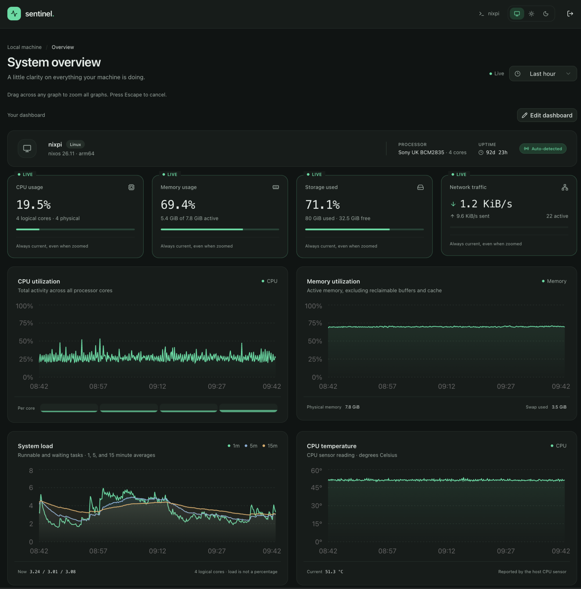

# Sentinel

Sentinel is a self-hosted system monitoring dashboard for Linux and macOS. It collects metrics in the background, displays live readings and historical charts, and stores history locally in SQLite. No separate database service is required.



- CPU activity, RAM and swap usage, filesystems, network traffic, uptime, load averages, and CPU temperature when available.
- Historical CPU and memory charts for the busiest processes.
- Time presets, custom ranges, and synchronized chart zoom.
- Customizable dashboard layout, colors, light/dark themes, and refresh interval.
- Password-protected dashboard and metrics API. Collection continues when the browser is closed.

Built with Bun, TanStack Start, React, TypeScript, and `systeminformation`. Run it directly on the machine you want to monitor, or add it to a Linux project's Docker Compose deployment.

## Build and run from source

Requires Bun **1.4.2**.

```sh
git clone https://github.com/nagy135/sentinel.git
cd sentinel
bun install --frozen-lockfile
```

Create `.env` in the checkout with your own credentials:

```dotenv
SENTINEL_USERNAME=admin
SENTINEL_PASSWORD=replace-with-a-long-unique-password
```

Replace the example password, keep `.env` out of Git, and restrict its permissions:

```sh
chmod 600 .env
bun run build
bun start
```

Open **http://127.0.0.1:3000** and log in. The server and collector start together. For development, use `bun run dev` instead of building and starting production.

By default, native runs listen on localhost and store history in `./data/sentinel.sqlite`. For a production installation, set `SENTINEL_DB_PATH` in `.env` to a persistent location outside the checkout.

## Add Sentinel to Docker Compose

This setup monitors the **Linux host running your project**, including host processes and filesystems. It does not provide per-container resource accounting or application-specific metrics. Docker on macOS exposes its Linux VM; use the native setup above to monitor the Mac itself.

### 1. Add the service

Add `sentinel` under your existing `services` section and `sentinel_data` under your top-level `volumes` section. Keep your application's existing services and volumes. The following also works as a standalone `compose.yml`:

```yaml
services:
  sentinel:
    image: ${SENTINEL_IMAGE:-viktornagy/sentinel:v0.3.1}
    restart: unless-stopped
    init: true
    network_mode: host
    pid: host
    uts: host
    environment:
      SENTINEL_USERNAME: ${SENTINEL_USERNAME:?Set SENTINEL_USERNAME in .env}
      SENTINEL_PASSWORD: ${SENTINEL_PASSWORD:?Set SENTINEL_PASSWORD in .env}
      SENTINEL_PUBLIC_URL: ${SENTINEL_PUBLIC_URL:-}
      PORT: ${SENTINEL_PORT:-3000}
      SENTINEL_HOST: "127.0.0.1"
      SENTINEL_HOST_ROOT: /host
      SENTINEL_INTERVAL_MS: ${SENTINEL_INTERVAL_MS:-5000}
      SENTINEL_DB_PATH: /data/sentinel.sqlite
    volumes:
      - sentinel_data:/data
      - type: bind
        source: /
        target: /host
        read_only: true
        bind:
          propagation: rslave
      - type: bind
        source: /sys
        target: /sys
        read_only: true

volumes:
  sentinel_data:
```

This is the service supplied in the repository's `compose.yml`. It uses shared network, PID, and hostname namespaces plus read-only host mounts to collect Linux host metrics. It runs as non-root, without privileged mode or a Docker socket. History and login sessions persist in `sentinel_data`.

### 2. Set credentials and a port

Add these values to `.env` beside your project's Compose file, preserving any existing application settings:

```dotenv
SENTINEL_USERNAME=admin
SENTINEL_PASSWORD=replace-with-a-long-unique-password
SENTINEL_PORT=3100
SENTINEL_INTERVAL_MS=5000
```

Replace the password and keep `.env` private with `chmod 600 .env`. Port **3100** leaves port 3000 available for your app; choose another unused port if needed. The service uses host networking, so do not add a `ports` mapping. Without `SENTINEL_PORT`, it defaults to 3000.

### 3. Start and open the dashboard

From your project's directory:

```sh
docker compose config --quiet
docker compose pull sentinel
docker compose up -d sentinel
docker compose ps sentinel
docker compose logs --tail=100 sentinel
```

These commands start Sentinel alongside your existing application. To start the whole project, use `docker compose up -d` without the service name. The published image supports AMD64 and ARM64.

Open **http://127.0.0.1:3100** on the Docker host and log in with your credentials. The dashboard listens only on the host's loopback interface. For a remote server, run this on your computer, then open the same local URL:

```sh
ssh -L 3100:127.0.0.1:3100 user@your-server
```

For an HTTPS reverse proxy, set `SENTINEL_PUBLIC_URL=https://status.example.com` in `.env` and rerun `docker compose up -d sentinel`. A proxy on the host can forward to `http://127.0.0.1:3100`. A proxy in a bridge-network container needs access to the host; its own `127.0.0.1` points to that proxy container.

### Build your own Docker image

From a Sentinel source checkout, build the included Dockerfile:

```sh
docker build -t sentinel:local .
```

On the same Docker Engine, set `SENTINEL_IMAGE=sentinel:local` in your deployment project's `.env`, then run from that project's directory:

```sh
docker compose up -d --pull never sentinel
```

### Updates and stored data

To use a published release, set `SENTINEL_IMAGE=viktornagy/sentinel:<version>` in `.env`, replacing `<version>` with the release tag. Then run:

```sh
docker compose pull sentinel
docker compose up -d sentinel
```

The named volume keeps metrics and login sessions through container restarts and replacements. Keep the Compose project name stable to reuse it. Stop monitoring with `docker compose stop sentinel`. **`docker compose down --volumes` deletes the combined project's named volumes, including Sentinel history and application data.**

## Configuration and login

Bun reads `.env` automatically; Compose passes the variables listed in the service definition. Restart or recreate Sentinel after changing settings.

| Variable | Default | Purpose |
| --- | --- | --- |
| `SENTINEL_USERNAME` | Required | Dashboard and API login username. |
| `SENTINEL_PASSWORD` | Required | Login password; missing credentials prevent startup. |
| `PORT` | `3000` | Native server port. |
| `SENTINEL_PORT` | `3000` | Host port for the Compose service above. |
| `SENTINEL_IMAGE` | `viktornagy/sentinel:v0.3.1` | Image used by Compose. |
| `SENTINEL_INTERVAL_MS` | `5000` | Collection interval in milliseconds; integer of at least 1000. Independent of browser refresh. |
| `SENTINEL_DB_PATH` | `./data/sentinel.sqlite` | Native SQLite path; Compose sets `/data/sentinel.sqlite`. |
| `SENTINEL_HOST` | `127.0.0.1` | Native bind address; accepts `127.0.0.1` or `0.0.0.0`. The Compose example also binds to localhost. |
| `SENTINEL_PUBLIC_URL` | Request origin | External HTTP(S) origin, such as `https://status.example.com`, for reverse proxies. |
| `SENTINEL_HOST_ROOT` | Unset | Linux host filesystem mount; the Compose service sets `/host`. |

Login sessions persist in `<SENTINEL_DB_PATH>.auth.sqlite`; back it up with the metrics database. Changing either credential revokes existing sessions on restart. HTTPS enables Secure cookies. `/healthz` exposes service health without login.

History has no automatic retention limit, so allow disk space for continued collection. Hiding dashboard blocks or changing the displayed time range does not delete data. Sensor availability depends on the host; missing readings remain unavailable.

## Development checks

```sh
bun run typecheck
bun run test:production   # build and test the production server
bun run test:docker       # requires Docker Engine
bun run test:docker:host  # requires Docker Engine on Linux
```
